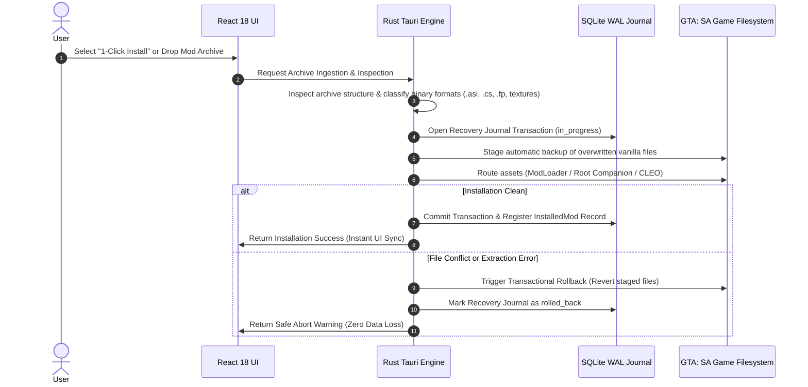

# San Andreas Mod Manager (SAMM)

[](https://github.com/athuls-engineer/samm/releases)
[](https://tauri.app)
[](https://www.rust-lang.org/)
[](https://react.dev/)
[](https://www.typescriptlang.org/)
[](https://opensource.org/licenses/MIT)

> **High-Performance, ACID-Compliant Transactional Mod Manager for Grand Theft Auto: San Andreas (Classic 1.0 US)**

SAMM is a modern, reliable mod manager designed specifically for GTA: San Andreas. Built from the ground up in **Rust** and **Tauri v2** with a high-density **React 18 / TypeScript** frontend, SAMM completely eliminates mod installation corruption, file collisions, missing companion assets, and aspect ratio distortion.

---

## Key Highlights

- **Zero-Data-Loss Transactional Architecture**: Every mod installation is staged as an ACID transaction. If an archive contains corrupt assets or conflicting hashes, SAMM automatically rolls back all filesystem modifications in reverse order, leaving the vanilla game directory untainted.
- **Automated 1-Click Catalog**: Integrated repository browser pre-loaded with over 100 verified mods (SilentPatch, SkyGfx, Widescreen Fix, Project 2DFX, First Person Mod, Cheat Menu, Ragdoll Physics, and HD Graphics) featuring one-click unattended download and deployment.
- **Smart ModLoader & Native Routing**: Automatically detects `.asi`, `.cs` (CLEO), `.sp`, `.fp`, config scripts, and font companion files, routing them to ModLoader subfolders or the root game directory based on RenderWare binary handler requirements.
- **RenderWare Aspect Ratio & Display Safety**: Enforces true 16:9, 16:10, and 21:9 geometry across loading screens and HUD elements, preventing narrow splash screens and squashed widescreen visuals.
- **Zero-Hook Conflict Prevention**: Automatically isolates duplicate root ASI plugins (e.g., colliding `GTASA.WidescreenFix.asi` or `Hooks.asi` 0x45A errors) to ensure error-free game boot.
- **Isolated Multi-Profile System**: Switch between different overhaul setups (e.g., Vanilla+ Quality of Life vs Total Conversion) instantly with independent virtual file profiles.
- **Dynamic Theming Engine**: Fully hardware-accelerated themes including Charcoal Dark, Midnight OLED (pure black), Nordic Slate, San Andreas Gold, and Grove Street Green.

---

## Architectural Workflow



---

## Core Capabilities

### 1. Intelligent File Classification & Asset Routing
ModLoader cannot natively parse custom binary save-state parameters (`.sp`), first-person view coordinate matrices (`.fp`), or proprietary font assets without dedicated helper handlers. SAMM's routing engine isolates these files and deploys them alongside the executable in the game root, while safely routing graphics, maps, textures, and standard ASI plugins into ModLoader.

### 2. ACID Rollback Journal
All operations are tracked in an embedded SQLite database (`samm.db`) operating in Write-Ahead Logging (WAL) mode. If an installation is interrupted or cancelled, SAMM executes an exact rollback sequence, ensuring no orphaned files remain.

### 3. Integrated Mod Repositories
Supports live search, category filtering, and direct downloads across major San Andreas community repositories:
- GTAInside
- MixMods
- LibertyCity
- GTAGarage

---

## Development & Build Instructions

### Prerequisites
- [Node.js](https://nodejs.org/) (v18+ or v20+)
- [Rust](https://rustup.rs/) (v1.80+)
- [Visual Studio C++ Build Tools](https://visualstudio.microsoft.com/visual-cpp-build-tools/) (MSVC)
- Windows 10/11 with WebView2 Runtime

### Clone & Install Dependencies
```bash
git clone https://github.com/athuls-engineer/samm.git
cd samm
npm install
```

### Run in Development Mode
Launches Vite development server alongside the Tauri native desktop window with hot module replacement:
```bash
npm run tauri dev
```

### Run Unit Test Suites
```bash
# Frontend TypeScript domain test suite
npm test

# Rust backend core unit tests
cargo test --manifest-path src-tauri/Cargo.toml
```

### Compile Production Release Binary
Produces an optimized, standalone executable with embedded assets:
```bash
npm run build
cargo build --release --manifest-path src-tauri/Cargo.toml
```
The compiled single-file binary will be located at:
```
src-tauri/target/release/samm.exe
```

---

## Technology Stack

| Layer | Component | Description |
| :--- | :--- | :--- |
| **Runtime & Shell** | [Tauri v2](https://tauri.app) | Low-overhead native Windows wrapper utilizing Microsoft Edge WebView2 |
| **Backend Engine** | [Rust](https://www.rust-lang.org) | High-performance concurrency, memory safety, and filesystem operations |
| **Database** | [rusqlite (bundled SQLite)](https://github.com/rusqlite/rusqlite) | WAL-mode transactional state store for mod records, backups, and profiles |
| **Frontend Framework** | [React 18](https://react.dev) | Declarative component UI with concurrent rendering |
| **Type Safety** | [TypeScript 5.6](https://www.typescriptlang.org) | End-to-end typed IPC contract and model definitions |
| **Styling** | [Tailwind CSS 3.4](https://tailwindcss.com) | Dynamic CSS variable-driven theme engine |
| **Icons** | [Lucide React](https://lucide.dev) | Modern, clean vector iconography |

---

## System Requirements

- **Operating System:** Windows 10 (64-bit) or Windows 11
- **Target Game:** Grand Theft Auto: San Andreas (Classic 1.0 US Executable)
- **Mod Engine:** ModLoader 0.3.8+ & CLEO 4+ (automatically detected and verified by SAMM)

---

## License

This project is licensed under the [MIT License](LICENSE).

Developed and maintained by [Athul S](https://github.com/athuls-engineer).

---

## 🤝 Authors & Contributors

* **Athul S** ([@athuls-engineer](https://github.com/athuls-engineer)) — Creator & Lead Systems Developer
* **Google Gemini** (AI Pair Programmer) — Co-developer assisting with Rust backend architecture, Tauri IPC commands, conflict resolution algorithms, and test suite design.
